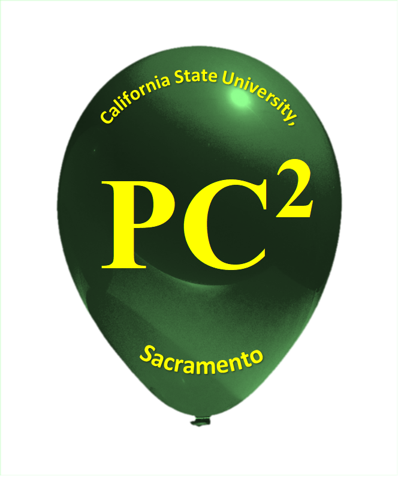
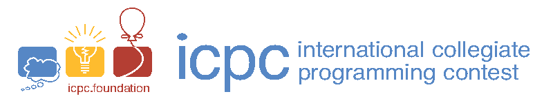
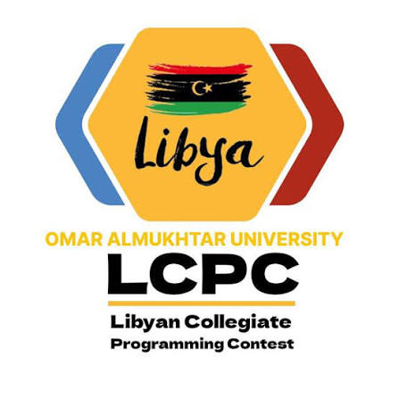

<p align="center">
  
  &nbsp;&nbsp;
  
  &nbsp;&nbsp;
  
  &nbsp;&nbsp;
  
</p>

# University Contest Platform for PC²

**v1.0.0 · First open-source release · [EPL-2.0](LICENSE)**

An organizer dashboard and configurable participant experience around **PC² 9.10.0 / Web Team Interface 1.1**. Developed and customized by **[Boamtoal](https://github.com/Boamtoal)** in the context of programming contests at **Omar Al-Mukhtar University (OMU), Libya**, to make preparation, judging and participant support easier for universities.

**PC² is the original contest engine.** It was developed at California State University, Sacramento by the PC² Development Team, including **John Clevenger, Douglas Lane, Samir Ashoo and Troy Boudreau**, with its upstream contributors. Their names, logos, copyright notices, original About screens and third-party acknowledgements retain their place. This project credits their work and does not claim authorship of PC² or WTI. See [full attribution](NOTICE.md), [PC² upstream](https://github.com/pc2ccs/pc2v9) and the [official PC² site](https://pc2ccs.github.io/).

## Read first

This initial release publishes the customization **source overlay**, documentation and synthetic fixtures. Install the matching upstream PC²/WTI distribution separately. No real university contest, account passwords, student submissions, private tests, problem booklets, logs, databases or VM disks are included.

The validated organizer environment is **macOS on Apple Silicon with a dedicated Lima VZ Linux ARM64 judge**. Native PC² supports other operating systems; this overlay's lifecycle and isolation are not yet validated on other organizer hosts. A clean-machine installation/restore, independent security audit and the intended physical client load still need local acceptance before relying on an event. Read [Installation](docs/INSTALLATION.md) and [Known limitations](docs/ROADMAP.md).

## What organizers can do

- Prepare separate contests with fresh accounts, statements, private judge data, difficulty and balloon colors; guard against two active managed contests.
- Use automatic judging, automatic results followed by human approval, or human-only decisions, with explicit final verdicts and audit records.
- Review source and retained compiler/runtime/validator evidence; compare current input, actual output and expected output without inventing historical evidence.
- Operate separate private live and freeze-aware public scoreboards, clocks, announcements and clarifications.
- Manage English/Arabic problem PDFs and supporting files, publish deliberately, and configure organizer and participant identities independently.
- Inspect bounded participant activity, observed browser connectivity, notifications, roles, TOTP and optional account/IP-approved HTTPS administration.
- Export CSV/PDF, encrypted recovery archives and private post-contest per-team learning packages with isolated replay and detailed test evidence.
- Read an English **User Guide** and **About** directly from the dashboard, even when a live contest snapshot is unavailable after sign-in.

## Documentation

| Document | Purpose |
| --- | --- |
| [Complete User Guide](docs/USER_GUIDE.md) | Everyday workflows, judging, network advice, troubleshooting and operating conditions |
| [Installation](docs/INSTALLATION.md) | Supported host, upstream dependencies, bootstrap and rehearsal |
| [Architecture](docs/ARCHITECTURE.md) | Components, trust boundaries, ports and data ownership |
| [Known limitations & roadmap](docs/ROADMAP.md) | Unfinished work and useful contribution areas |
| [Administrator coverage](lcpc/admin/PC2-ADMINISTRATOR-COVERAGE.md) | Native tools, destinations and integration boundaries |
| [Participant diagnostics](lcpc/admin/PARTICIPANT-DIAGNOSTICS.md) | Identity verification, retention and monitoring limitations |
| [Security policy](SECURITY.md) | Private reporting and responsible operation |
| [Contributing](CONTRIBUTING.md) | Development, tests and preserving upstream rights |
| [Changelog](CHANGELOG.md) | Release history |

**Use a real router or dedicated access point, preferably a wired organizer server.** Phone hotspots can produce DHCP exhaustion, disconnections and client isolation. After dependencies are installed, local contest traffic does not require Internet access. Always rehearse from the actual team laptops; a server-only check cannot certify the LAN.

## Development and contribution

Everyone is welcome to study, use, modify and improve this release under EPL-2.0. Start with [Contributing](CONTRIBUTING.md). Keep changes focused and add relevant synthetic regression checks. Preserve PC²/WTI and third-party credits. Do not upload private competition data to issues or pull requests.

```sh
python3 tools/build-guide.py --check
node --test lcpc/admin/tests/*.test.cjs lcpc/branding/tests/*.test.cjs
python3 -B -m unittest discover -s lcpc/admin/tests -p 'test_*.py'
```

Some checks need the separately installed native Java libraries or PDF packages; prerequisites and operational-test boundaries are documented in [Contributing](CONTRIBUTING.md). Do not run infrastructure acceptance scripts blindly on a live event.

## License and identity

New project source is available under **EPL-2.0**; upstream and bundled third-party components retain their notices and licenses. See [LICENSE](LICENSE) and [NOTICE.md](NOTICE.md). University, contest, PC² and ICPC logos/names identify their respective owners; the code license grants no trademark rights or endorsement. Configure your institution's participant/dashboard identity instead of presenting another university's branding as your own.
